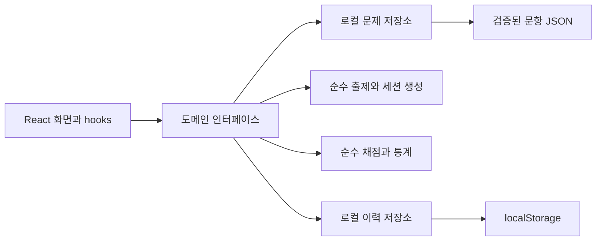

# 아키텍처

## 실행 모델

AI Literacy Lab은 정적 GitHub Pages에 배포하는 React SPA입니다. 서버 프로세스와 데이터베이스 없이 브라우저에서 문제를 조회하고 세션을 만들고 채점합니다. Vite는 `/AI-Literacy-Lab/`를 asset base로 사용하고 React Router의 `HashRouter`가 정적 호스트의 경로 새로고침을 처리합니다.



도메인은 React, DOM, `localStorage`, 네트워크 요청을 참조하지 않습니다. 화면은 서비스 경계를 통해 조회·출제·채점·저장·분석을 요청합니다. React 상태와 hooks는 현재 문항·다이얼로그·저장 알림 같은 UI 상태를 다룹니다.

## 주요 책임

| 영역                  | 책임                                           |
| --------------------- | ---------------------------------------------- |
| `src/app/`            | 앱 초기화·라우팅·서비스 연결                   |
| `src/components/`     | 네비게이션·버튼·모달·상태·공통 UI              |
| `src/pages/`          | 대시보드·Stage 1 소개·응시·결과·기록 화면      |
| `src/domain/`         | TypeScript 모델·문항 검증·출제·채점·학습 분석  |
| `src/data/questions/` | 독립 JSON 문제은행과 로드 진입점               |
| `src/infrastructure/` | 도메인 인터페이스의 로컬 구현·저장소 오류 복구 |
| `scripts/`            | 문항 검증 및 JSON·JSONL·Markdown 임포트        |
| `tests/`              | 통합·브라우저 E2E 테스트                       |
| `.github/workflows/`  | CI와 Pages 배포                                |

작은 기능은 현재 규모에 맞춰 페이지와 hooks로 구성하고, 복습·분석·응시 엔진의 비즈니스 규칙은 도메인과 서비스에 유지합니다.

## 교체 가능한 서비스 경계

`src/domain/types.ts`에 다음 계약을 정의합니다.

| 인터페이스                 | 현재 계약                                                                                      | 최초 구현                                   |
| -------------------------- | ---------------------------------------------------------------------------------------------- | ------------------------------------------- |
| `QuestionRepository`       | `getAll`, `getByIds`                                                                           | 번들 JSON 조회                              |
| `AssessmentService`        | `create`                                                                                       | 로컬 문제은행으로 순수 `createSession` 실행 |
| `EvaluationService`        | `evaluate`                                                                                     | 순수 `evaluateSession` 실행                 |
| `ProgressRepository`       | `load`, `saveActive`, `saveResult`, `toggleBookmark`, `exportData`, `importData`, `getWarning` | 버전 있는 로컬 저장소                       |
| `LearningAnalyticsService` | `summarize`                                                                                    | 제출된 결과에 대한 순수 집계                |

현재 계약은 브라우저에서 동기적으로 동작합니다. 원격 API를 도입할 때에는 이 경계에서 비동기 반환형과 로딩·실패 상태를 추가해야 합니다. 네트워크 통신을 각 화면에 흩어 넣지 않고 어댑터와 서비스 연결부를 변경하는 방향을 유지합니다. 서버가 없는 현재 단계에서는 작동하지 않는 API endpoint를 만들지 않습니다.

## 문제 모델과 출제

현재 출제 유형은 `type: "single_choice"`, `stage: 1`입니다. 문항은 영역·난이도·고유 ID·선택지·정답·전체 해설·선택지별 해설·태그·출처 유형·버전·게시 상태를 포함합니다. 스키마는 지원하지 않는 유형, 누락된 해설, 잘못된 정답과 중복 ID를 거부합니다.

- `published` 문항만 출제합니다. 검토 중 문항은 `review`로 유지합니다.
- 학습은 기본 10문항, 모의평가는 기본 20문항입니다. 필터와 가용 문항 수를 먼저 계산해 부족한 경우 가능한 수만 반환합니다.
- 영역과 난이도를 고려하고 가능한 한 직전 응시 문항을 피합니다. 문항과 선택지는 섞되 해당 세션에 저장하여 순서를 고정합니다.
- `questionIds`, `displayedOptionOrder`, `questionVersion`, 문항 스냅샷을 세션에 저장합니다. 문제은행을 변경해도 진행 중 응시와 과거 결과의 정답 기준을 바꾸지 않습니다.
- 새 문제 유형은 `type`을 판별자로 하는 별도 타입·검증·렌더러·평가기를 추가하도록 확장합니다. 복수선택·서술형·과제형의 현재 지원을 암시하지 않습니다.

## 세션과 채점

진행 중인 `AssessmentSession`과 제출된 `EvaluationResult`는 분리합니다. 답안은 문항 ID에 대한 선택지 ID이며 현재 세션의 문항과 선택지만 허용합니다. 선택·문항 이동·해설 열람 상태를 저장합니다.

시간 제한이 있는 모의평가는 시작 시각과 고정 마감 시각 `deadlineAt`을 저장합니다. 새로고침으로 타이머를 다시 시작하지 않고 실제 현재 시각과의 차이로 남은 시간을 계산하며 만료 시 제출합니다. 시간 제한을 해제한 경우 마감 시각은 `null`입니다.

순수 채점은 화면 상태에 의존하지 않습니다. `correctCount + incorrectCount + unansweredCount = totalQuestions`이며 `incorrectCount`는 답을 골랐지만 틀린 수입니다. 미응답은 점수 계산에서 0점입니다. `score`와 `accuracy`는 모두 `correctCount / totalQuestions × 100`을 소수점 한 자리로 반올림하고 영역별 정답률도 전체 출제 수를 분모로 사용합니다.

제출은 응시 ID를 기준으로 멱등 처리합니다. 이미 저장된 같은 응시 ID의 결과를 바꾸지 않습니다. 결과는 제출 당시의 문항·정답·선택지 배열·답안·버전과 함께 복사하여 보관하고 도메인에서 변경 불가능한 값으로 취급합니다.

## 로컬 저장과 백업

저장 namespace는 `ai-literacy-lab:v1`입니다. `${prefix}:head`에는 `{ version: 1, generation }`을 저장하고 해당 세대의 `active`, `results`, `bookmarks`를 별도 키에 저장합니다. 기본 세대는 `default`입니다. `${prefix}:generation:${generation}:active` 같은 각 record 역시 버전을 포함합니다.

개인 기록 내보내기는 다음 최상위 형식의 JSON입니다.

```json
{
  "version": 1,
  "activeSession": null,
  "results": [],
  "bookmarks": []
}
```

가져오기는 구조뿐 아니라 문항·답안 참조, 선택지 순서, 버전, 시각, 중복 응시, 채점 집계의 정합성까지 검사합니다. 전체를 검증한 후 새 세대에 record를 저장하고 마지막에 head를 교체해 기존 기록의 일부만 바뀌는 상황을 피합니다. 가져오기는 병합이 아닌 전체 교체입니다.

손상되거나 지원하지 않는 버전은 앱 전체 오류로 전파하지 않습니다. 가능한 경우 원본 문자열을 `${prefix}:quarantine:…` 키에 보존하고 영향을 받은 record를 빈 상태로 복구하며 경고합니다. quota·보안 정책 등으로 저장소를 사용할 수 없으면 메모리로 계속 동작하고 영속 저장의 실패를 표시합니다.

저장 연산마다 최신 record를 다시 읽어 탭 간 오래된 상태를 줄입니다. 동시에 수행되는 여러 탭의 `localStorage` 쓰기를 잠그는 기능은 없으므로 최종 저장이 우선할 수 있습니다. 학습 기록을 교체할 때에는 다른 탭의 응시를 종료하고 현재 기록을 먼저 백업하는 것이 좋습니다.

이 무결성 검증은 실수와 손상으로부터 개인 기록을 보호하는 장치입니다. 사용자가 제어하는 브라우저 데이터의 공식 성적 진위를 증명하지 않습니다. `localStorage`와 JSON 백업은 사용자 단말에 존재하므로 백업 파일의 공유와 보관은 사용자가 선택합니다.

## 테스트와 배포

Vitest는 순수 출제·채점·검증·분석 및 저장 어댑터를 검증합니다. Testing Library는 사용자 관점의 UI 상호작용을 검증하고 Playwright는 Chromium으로 화면 이동·응시·새로고침·제출·복습·기록 흐름을 검증합니다. 실제 실행 범위와 결과는 [구현 계획의 검증 기록](IMPLEMENTATION_PLAN.md)에 적습니다.

현재 실행 결과는 Vitest·Testing Library 54개와 Chromium 17개 통과입니다. Chromium에는 7개 화면 상태의 Axe WCAG A/AA 자동 검사와 해시 라우트를 보존하는 본문 건너뛰기 회귀 검증이 포함됩니다. 자동 규칙과 키보드 점검은 접근성의 일부 검증이며 수동 스크린리더 평가·WCAG 전체 적합성 인증으로 보고하지 않습니다.

재사용 CI는 Node.js 22에서 `npm ci`, lint, 문항 검증, 단위/통합 테스트, 빌드와 Chromium E2E를 실행합니다. Pages 워크플로는 main push 또는 수동 실행 시 CI를 호출하고 모든 검증이 성공하면 `dist/` artifact를 별도 배포 job에서 게시합니다. PR에서는 배포하지 않습니다.

## Stage 2·3 및 백엔드 확장

Stage 2·3은 현재 준비 중이며 실제 과제 실행·AI Assist·서술형 채점을 제공하지 않습니다. 공통 네비게이션·레이아웃·접근성 컴포넌트, 문항 출처/버전 관리, 진행/제출 상태 분리, 결과·분석·저장 인터페이스를 재사용할 수 있습니다. 새로운 Stage는 별도 경로와 화면, 해당 유형의 스키마 및 평가기부터 추가합니다.

로그인·클라우드 문제은행·기기 동기화를 도입하면 Supabase 또는 별도 API 서버의 어댑터를 추가하고 사용자별 권한과 네트워크 실패 처리를 서비스 경계에 구현합니다. 기존 로컬 백업은 명시적인 사용자 동의·검증을 거쳐 계정 기록으로 이전합니다. 공용 화면을 그대로 재사용하기 위해 현재 기록 구조를 서버 내부 권한 모델로 오해하지 않습니다.

AI Assist·서술형 자동 채점은 **서버에서** 비밀키 보관, 인증, 입력 검증, 요청 제한, 비용 제한, 감사 로그, 평가 실행을 처리합니다. `VITE_*` 변수와 React 번들은 공개 데이터이므로 API 키를 넣지 않습니다. 비공개 정답이 필요한 공식 평가는 정답 배포를 중단하고 서버가 문항 공개 범위·세션 권한·채점·결과 서명을 소유해야 합니다. 현재 로컬 채점 모델에 보안성만 덧붙였다고 주장하지 않습니다.
